# Browser-wallet flows (Playwright)

Recorded against https://whiteflag-ledger.vercel.app on the demo registry `0x0c5c9cB1826530A5a90cA1676cA0477F36FC9D55` with throwaway wallets injected as `window.ethereum` ([test/e2e/wallet.mjs](../../test/e2e/wallet.mjs)): each transaction the site asks for is signed with a local test key and sent raw to Studio Dev, as MetaMask would. Spec: [test/e2e/flows.spec.mjs](../../test/e2e/flows.spec.mjs). Offers: claim flow #13, refund flow #14. Result: [results.json](results.json) (1 passed), log: [run.log](run.log).

Videos: [protocol wallet](protocol.webm), [exploiter wallet](exploiter.webm).

### 01. Create an offer: the protocol's throwaway wallet fills the form (wfdemo, exploiter = the e2e exploiter wallet)

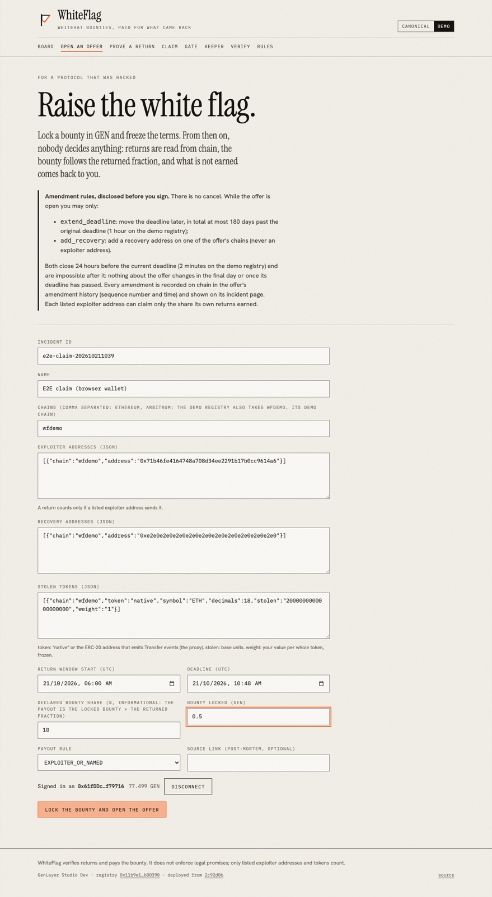

### 02. Offer accepted and confirmed in contract state

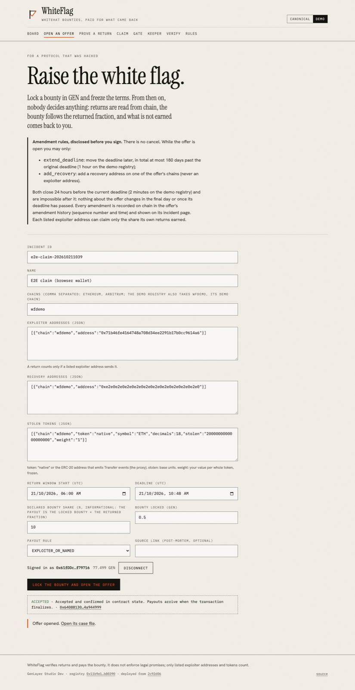

### 03. The new offer's case file

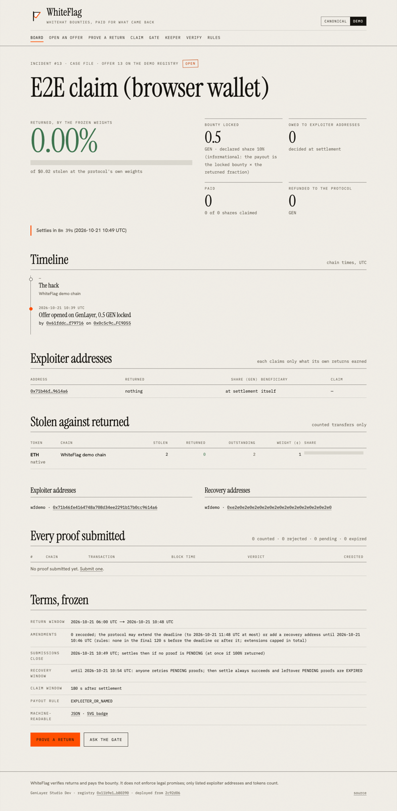

### 04. Submit proofs from the exploiter wallet: its own return and a stranger's transfer

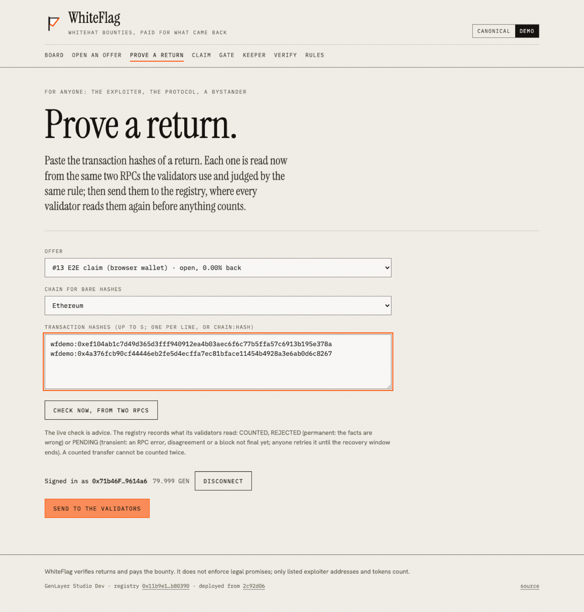

### 05. Recorded by the registry: one COUNTED, one REJECTED (SENDER_NOT_EXPLOITER)

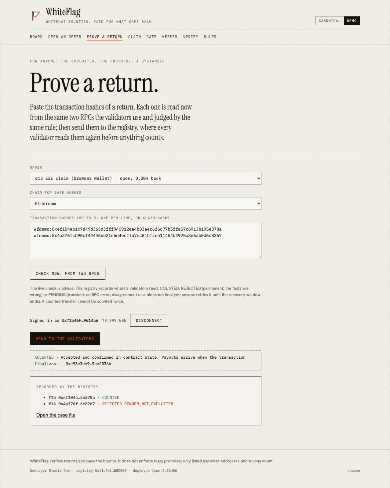

### 06. Successful finalization of the proof transaction

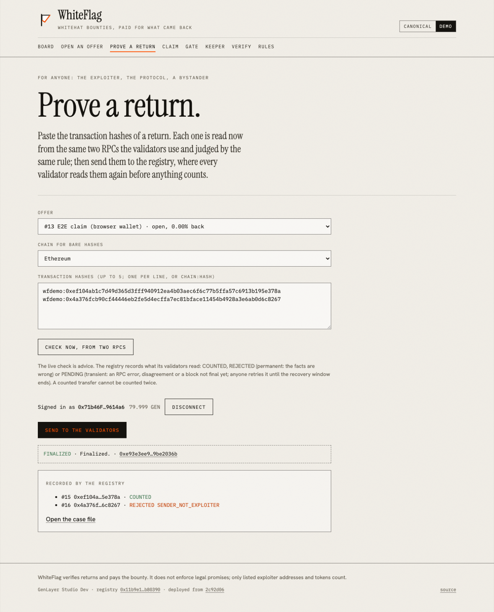

### 07. Settle from the claim desk once the settle time passed

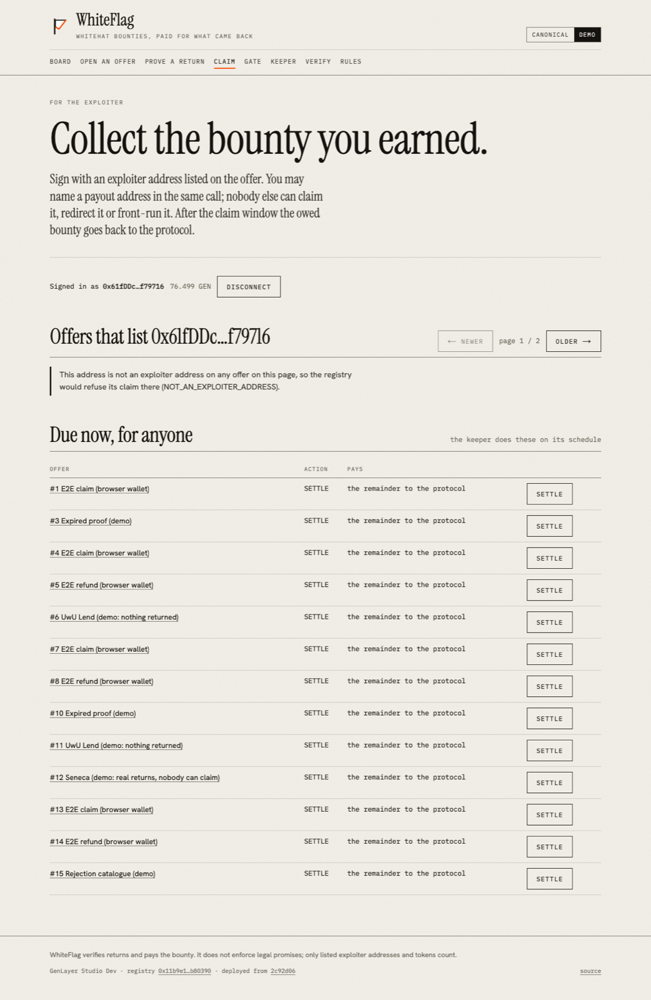

### 08. The exploiter wallet sees its own share

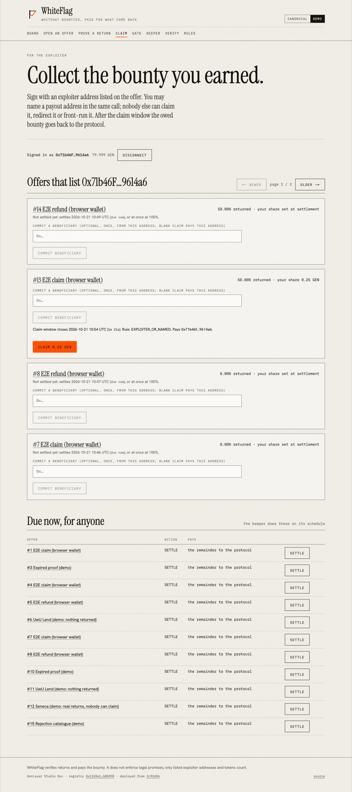

### 09. Claim accepted: paid exactly its share

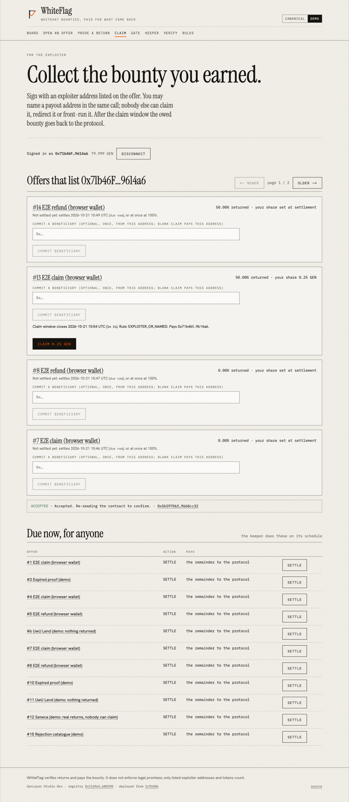

### 10. Refund: the unclaimed share of the second offer after the 3 min claim window

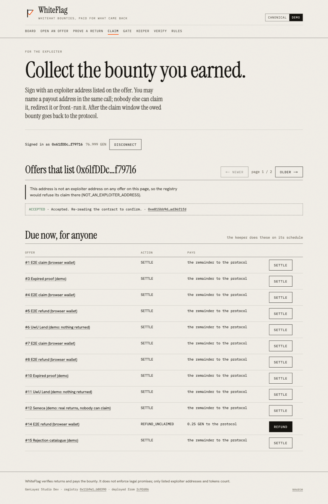

### 11. Case file after settlement and claim: shares by address

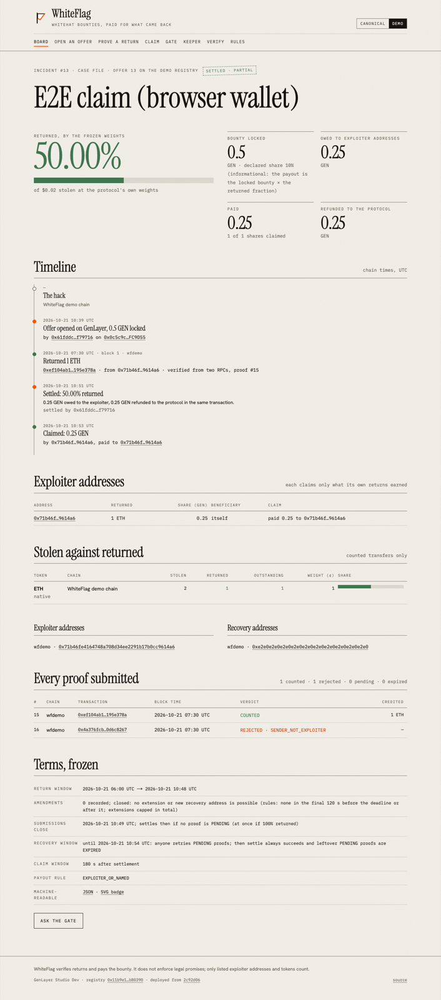
